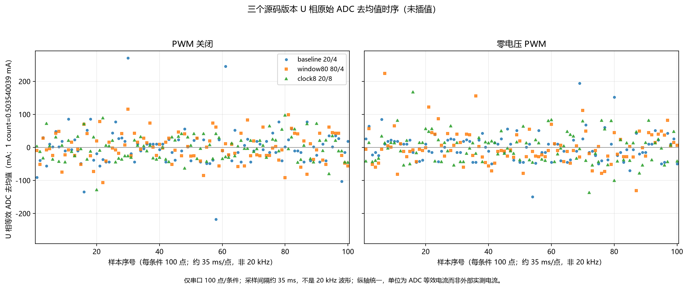

# ADC A/B 实机对照报告

日期：2026-11-07
项目：`HPM6E_servo_hub_dsh`
范围：仅 PWM 关闭、零电压 PWM；100 点/条件；约 35 ms/点；无转动试验。

## 结论

三个源码版本（baseline 20/4、window80 80/4、clock8 20/8）已完成实机对照。A/B 都**没有消除** 37~71 mA 量级的 ADC 等效噪声；小样本存在离群点，不能据此宣称任何版本“无差异”或“已修复”。10 RPM 速度故障未复测，仍未修复。

本报告的电流量均为 **ADC 等效读数**（1 count = 0.503540039 mA），不是外部电流探头实测值。原始 `st` 三相不是同拍采样，因此不能做三相和、相关性或真实 PWM 频谱分析。

## 三相 σ 表

单位 mA；由 100 点原始 ADC 计数计算，`ddof=0`，与 `summary.json` 逐项一致（最大差 0.0 counts）。完整数值见 `data/sigma_table.json`。

| 固件/版本 | 关 PWM U/V/W | 零 PWM U/V/W |
|---|---|---|
| 原固件 original | 50.893 / 53.421 / 47.012 | 43.629 / 50.063 / 49.890 |
| baseline 20/4 | 57.588 / 60.980 / 49.669 | 43.111 / 37.045 / 70.602 |
| window80 80/4 | 43.733 / 48.763 / 44.244 | 50.635 / 53.993 / 62.280 |
| clock8 20/8 | 37.442 / 40.054 / 46.907 | 46.186 / 54.134 / 47.925 |
| 恢复原固件 restored | 48.463 / 55.953 / 45.815 | 52.792 / 50.907 / 46.236 |

全体最小值 37.0 mA（baseline，V，零 PWM），最大值 70.6 mA（baseline，W，零 PWM）；约 37~71 mA。窗口 80 与时钟 8 的个别相下降，但其他相上升或持平，不能形成一致改善。

## 单变量与版本差异

- **window80**：相对 baseline 只改 `BOARD_BLDC_ADC_CHANNEL_SAMPLE_CYCLE` 20→80，`clock_div` 仍 4。关 PWM 的 U/V/W 从 57.6/61.0/49.7 变为 43.7/48.8/44.2；零 PWM 变为 50.6/54.0/62.3。方向不一致。
- **clock8**：相对 baseline 只改 `BOARD_BLDC_ADC_CLOCK_DIV` 4→8，窗口仍 20。关 PWM 降到 37.4/40.1/46.9；零 PWM 为 46.2/54.1/47.9。关 PWM 下降明显，但零 PWM 并非同向，且样本仅 100 点。
- **原固件 vs baseline**：板上原固件多数 Flash 段与源码 baseline 不同（`partial_manifest.json`：多个段 `match=false`）。原固件与 baseline 的 σ 也不相同，不能把两者混为同一版本。
- **恢复原固件 vs original**：数值相近但不相同（例如零 PWM U 43.6→52.8、W 49.9→46.2）；只能说“相近/未显示稳定差异”，不能说完全无差异。
- 两个 A/B 都是严格单宏变化；没有同时改窗口和时钟。

## 数据限制

- 每个条件下仅 100 个串口样本，间隔约 35 ms；不是 20 kHz 波形，不能做 FFT 或 PWM 频谱结论。
- `st` 的 U/V/W 是顺序读取，不是同拍；不能计算三相和或相间相关性。
- ADC 读数为等效电流；不能替代外部电流探头/示波器实测。
- 小样本离群点会显著影响 σ；未做剔除，也未据此认定异常样本。
- 未复测 10 RPM；速度模式“只抖不转”仍未解决。此前静止编码器 1 count pp 不能作为电流噪声根因证据。
- 完整 4 MB 回退已独立重新读取并与原始备份逐字节比较一致；参数恢复已用设备新响应验收，见下文。

## 图表

- `figures/adc_u_demeaned.png`：baseline/window80/clock8 三个源码版本的 U 相原始 ADC 去均值时序；PWM 关闭、零电压 PWM 两面分面，统一 Y 轴；每条件 100 点；仅画原始点，未插值。图中采样率明确标为非 20 kHz。
- `figures/adc_three_phase_std.png`：五个固件/版本、两种条件下的 U/V/W 三相 σ 对比；纵轴为 ADC 等效 mA。

图表源码：`scripts/make_adc_ab_report.py`；数据核对：`data/analysis_console.log`、`data/sigma_table.json`。

## Flash 备份与构建一致性

- `probe_info.log`：`flash 'hpm_xpi' found at 0x80000000`，`size 0x00400000`（4 MB），4 kB 扇区 1024 个；**原始 16 MB 声明不是实测容量**。
- `flash_part0.bin` 为探测到的完整 4 MB 备份，SHA256 `822609d23aedc11f1dc4c692306a86773b2b493c4f9f0dcb35da32333cea9d08`；前 1 MB 独立复读逐字节一致，SHA256 `be77d6b3de86c15d7677651dbd9b5e87c8031eb8a6a9671870e712b279c1b4f5`。
- 已保存 `flash_baseline.log`、`flash_window80.log`、`flash_clock8.log`、`flash_rollback_original.log` 和 `probe_info.log`；`verify_restored4MB.log` 记录完整复读结束且 CPU 恢复运行。
- 已记录的烧写/擦除范围均在已备份前 1 MB 内；不能外推为完整 4 MB 回退完成。
- 4 MB 实测、`BOARD_FLASH_SIZE=16MB`、OpenOCD bank 32MB 的差异是附带发现，暂未修改源码；**没有证据表明该差异导致 ADC 噪声**。
- 源码 `board.h` 已恢复 20/4；已重编 baseline，`build-hpm6e80/output/demo.elf` 与 baseline 归档一致：ELF `ec5f0444...16d23`，BIN `af423b4d...22e3`。当前 output 与 checkout 一致。

## 回滚与最终状态验收

- 原始与恢复后整片 4 MB Flash 的 SHA256 均为 `822609d23aedc11f1dc4c692306a86773b2b493c4f9f0dcb35da32333cea9d08`，逐字节一致；见 `data/restoration_manifest.json`。原始备份保留于 `D:/Documents/ChatGPT/YeeZi/adc_ab_backup/flash_part0.bin`，二进制不纳入本次 Git 文档提交。
- 恢复后的真实读参响应覆盖 84 个报文；检查所有配置/参数与本轮实际更改的命令字段，没有不一致。首次恢复时两个 SM 保护字段被权限同步覆盖，已在权限同步后再次恢复原 SM 配置并用设备新响应复核；见 `data/final_params_verified.json`。
- 最终上位机 COM4/921600 在线、心跳正常、解析错误 0、电机失能、无错误、APP 权限/模式 0、速度目标 0，位置 14905 counts 与本轮供电后快照一致。所有 ADC 条件的编码器实际位置范围仅 14905～14906 counts；未出现可见运动。
- 当前板上为本轮开始时的原始固件；当前源码及 output 为 20/4 baseline。原始固件与源码 baseline 仍不同，后续请明确选择归档产物，不能把源码与板上版本已统一当作既成事实。
- 采集脚本、固件段及回滚验证脚本保留在 `scripts/`；依赖本机 Python312/PySerial，图表使用既存 `D:/Documents/ChatGPT/YeeZi/filter-study/plot-libs`，未新增依赖安装。

## 下一步最小可区分测量

保持电机失能，只做一次同步测量：

1. 示波器同时看 U/V/W 采样前端（ADC 引脚或运放输出）、VDDA、VREF，并以 PWM 触发为时间基准。
2. 同一时间窗用 DMA 原始 ADC 抓取至少 1000 点，保留通道/触发/有效位标签；与示波器对齐。
3. 做三组对照：PWM 关闭、零电压 PWM、ADC 输入端注入已知小直流/交流信号。

若 ADC 输入端安静而 raw 仍抖，优先查 ADC/基准/DMA 有效标签；若 ADC 输入端本身抖动，则查前端、VDDA/VREF 与 PWM 开关耦合。该测量不依赖 35 ms 串口采样，也不把三相顺序读数当同拍数据。

## 产物清单

- `data/measurements/{original,baseline,window80,clock8,restored}/raw_console.json,summary.json`
- `data/variant_verified.json`、`data/partial_manifest.json`、`data/original_parameter_snapshot.json`
- `data/sigma_table.json`、`data/analysis_console.log`
- `patches/{baseline_20_4,window80_80_4,clock8_20_8}/board.patch,manifest.txt`
- `data/logs/`：烧写/校验日志及 `probe_info.log`（无 bin/elf、无重复构建日志）
- `figures/adc_u_demeaned.png`、`figures/adc_three_phase_std.png`
- `scripts/make_adc_ab_report.py`

本轮实机先后烧录 baseline/A/B，最后恢复原固件；临时 ADC 源码改动已恢复，精确补丁保留在 patches/。未安装依赖或修改全局设置。阶段数据、补丁与报告纳入 Git。
