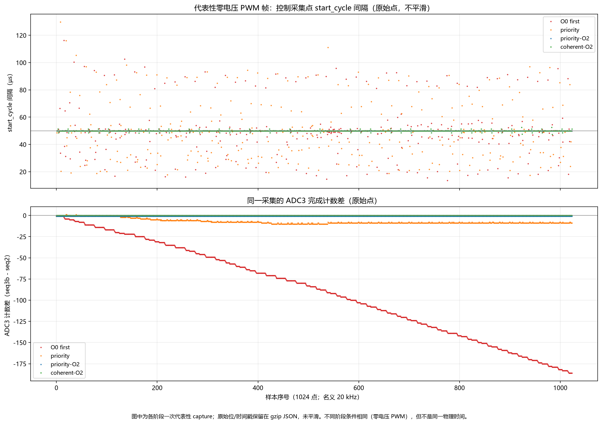

# 2026-11-07 DMA/ADC 时序收尾报告

> **结论：速度控制仍未通过。** 本轮修正了 ADC IRQ 优先级意图与实际相反、控制环可能混用上一 PWM 帧 V 数据的路径，并通过 O2 显著收窄执行间隔波动；尚未证明所有工况均满足单周期期限。修复后 ADC3 计数差从 105~200/1024 降到 ±9，coherent 版本稳定为 0 差；但 raw ADC 仍有约 41~57mA 等效 σ，低增益 10RPM 仍不合格。没有锁轴、外部示波器或独立转速时，不能把剩余现象唯一归因于真实运动、磁编码器受电流扰动或模拟采样噪声。

## 数据与口径

- 数据源：`D:/Documents/ChatGPT/YeeZi/dma_measurements/{first,confirm,priority,o2,coherent}`。
- 5 组共 **18 个 1024 点 capture、18,432 行**。
- raw 已用 `gzip.compress(..., mtime=0)` 无损归档到 `data/raw/<dataset>/raw_console.json.gz`。
- `first` 2 组；`confirm/priority/o2/coherent` 各 4 组。
- 完整 analysis JSON、速度/电流 JSON、flash 日志、patch、构建 manifest 见 `data/manifest.json`。
- 同一 PWM 帧的三相采样有顺序孔径，**不是三相绝对同时**。
- VBUS ADC 数值不能按电流 mA 解释。
- 速度数据中的 scope `dt_s=0.008s` 是名义值；真实起止/抖动未由 QTimer 事件严格对齐。

## 已修正的采集路径与已验证的时序改善

### 1. IRQ 优先级意图

- 原代码 ADC2=6、ADC3=5；HPM PLIC 数值越大优先级越高（`hpm_plic_regs.h:67-69`）。
- 原注释“ADC3 更高”与配置相反。
- 交换为 ADC3=6、ADC2=5 后，ADC3 最终落后从 **105~200/1024** 变为 **±9**。
- priority 组四次 capture 的末差为 -1/+3/-9/+4。
- ADC3 pending 从数百次降到 **0~4**。
- priority-O0 的 ADC2 start 间隔仍可达约 **165us**，说明优先级不是唯一限制。

### 2. O0 大延迟

- priority-O0 的 start 间隔约 **15~165us**。
- priority-O2 缩到约 **40~60us**。
- 其中一组 O2 为 **49.905~50.105us**。
- 这确认 O0 的 1kHz 代码路径足以跨过 20kHz ISR 期限。
- 但 O2 仍有过冲，raw 噪声未消失。

### 3. V 上一帧数据路径

- ADC3 V/VBUS 约 4.44us 完成后才进 ISR。
- 原控制由 ADC2 ISR 启动，`kBspData.adc_v_raw` 可能仍是上一帧。
- coherent 版本改为 ADC3 完成 ISR 作为唯一控制节拍。
- 先清 ADC3、fence、拷贝 V/VBUS。
- 再由 `board_control_tick()` 检查/清 ADC2、fence、拷贝 U/W。
- ADC2 外部 IRQ 不 enable；DMA/完成标志仍工作。
- ADC2 未完成只递增 `ADC2_tick_not_ready`，不忙等。
- 原有 20kHz/1kHz 任务没有迁移。
- coherent 实测 ADC3 计数差 **0**、copy race **0**、`ADC2_tick_not_ready` 采集前后 **0**、无冲突/FIFO/AHB 错误。
- **这只证明同帧数据路径按设计工作，不等于速度或底噪已解决。**

## 速度结果

### baseline

- Kp=0.102 / Ki=7.67 / iqmax=0.3。
- 零目标使能后即失稳至约 ±600RPM。
- 500RPM 保护触发 err3。
- 该次是**短时使能后保护**，不是从未使能。
- 非零目标尚未发送；不能代表完整速度性能。

### lowkp

- `dma_speed_lowkp_aborted_graph.json`：实时图表映射错误导致误 guard 中止，**不是有效 10RPM 测试**。
- `dma_speed_lowkp.json`：Kp=.001 / Ki=7.67 / iq=.1，真实目标 10RPM 到达，但平均速度很低。
- 与原 case 的限流/IRQ 不同，不能单归因 Kp。

### 相同低增益三版本

目标由 scope channel1 的实际 p/s 计算，取目标期间 mask；下表速度由位置差分计算，不能等同于独立转速测量。

| 版本 | 目标 mean/std/peak RPM | 反馈 mean/std/peak RPM | 位置净变化 counts | 位置差分平均 RPM |
|---|---|---|---|---|
| priority-O0 | 10.0 / 0 / 10.0 | 10.057 / 33.339 / 362.55 | 15,189 | 10.077 |
| priority-O2 | 10.0 / 0 / 10.0 | 9.824 / 27.963 / 291.60 | 16,439 | 9.837 |
| coherent-O2 | 10.0 / 0 / 10.0 | 9.837 / 29.871 / 321.81 | 16,396 | 9.850 |

- 三版本 target 都是 10RPM。
- 反馈有 290~363RPM 突发。
- 仍未达到可验收的稳定 10RPM。
- 不能承诺只是默认增益问题，也没有定位唯一根因。

## raw ADC 与电流回归

- 18 组 capture 的 U/V/W 等效 σ 最小 **41.25mA**、最大 **56.53mA**。
- O0/priority/O2/coherent 均未消除。
- `dma_current_regression.json`：同帧修正版 d 目标 0.2A，256 点 20kHz。
- 后 128 点 id 均 **195.656mA**、std **75.469mA**。
- iq 均 **-0.883mA**、std **30.681mA**。
- 平均误差约 **-2.2%**，仍明显纹波。
- 这是单点回归，不是全电流性能验收。
- scope 命令先设 ref 再 arm，不能测绝对最初上升延迟。

## PI 量纲的最后一次 RAM 对照

生成电流环先算 `P=Kp*bandwidth*error`，再积分 `Ki*P*dt`，因此历史文档直接把并联积分增益 `R*wc` 当作这里的 Ki，会得到不同带宽。本轮仅在 RAM 尝试按配置模型 `R/L≈15128/s`，速度增益保留原 0.102/7.67，电流限额 0.1A。真实 10RPM 目标段有 466 点；scope 速度均值 -0.048RPM、标准差 175.228RPM，全段绝对峰值 315.081RPM，仍未通过，结束无故障并失能。

该试验没有证明这项改值能修复速度，也不证明配置中的 R/L 已经外部校准。没有保留新 Ki：原 d/q Ki=3562 已恢复并新读回；证据为 `data/speed/dma_speed_currentki.json` 与 `data/currentki_trial_summary.json`。各组限流/速度增益不同，不作同条件性能提升比较。

## 上位机与运行时映射

- `mcp_dma_graph_units/resync` 等显示：控制板复位/烧录后设备 map 默认 index1，而 UI 仍用旧标签。
- `p.send30018` 原完整映射 + `read_struct30018` 已**运行时恢复**；上位机 exe 源码未修复。
- `read_all` 跳过 4 种 scope/map 消息：完整快照 84，实际 fresh 非 scope 参数 80。
- 不能再宣称“84 种 fresh 全收到”。
- 实时 graph 的速度字段是 int32，不能按 float bits 解码。
- 旧 baseline 的 live guard 部分解析无效；速度保护和 scope 是可靠判据。

## 归档与哈希

| 项目 | 值 |
|---|---|
| final coherent ELF | `2f3bbf9c4606fcb581ac02bd162fa571716002792f844cb232d59a770c635a76` |
| final coherent BIN | `0bbc79407184771061211df150cfe3d6a9320eade8bf548012b58b6f6778b8fc` |
| priority-O0 ELF | `5f136f46...` |
| priority-O0 BIN | `8d16c1ee...` |
| priority-O2 ELF | `a4318660...` |
| priority-O2 BIN | `79cabd08...` |

- 源码 patch：`patches/board_priority.patch`、`patches/servo_console_adcinfo.patch`、`patches/source_git_diff_o2.patch`、`patches/source_coherent.patch`。
- 构建 manifest：`manifests/dma_priority_manifest.txt`、`manifests/dma_o2_manifest.json`、`manifests/dma_coherent_manifest.json`。
- build evidence：`build_evidence/DMA_CAPTURE_RESULT.md`、`DMA_TIMING_RESULT.md`、`DMA_PRIORITY_RESULT.md`、`DMA_O2_RESULT.md`、`DMA_COHERENT_RESULT.md`、`dma_boundary_check.log`。
- flash 日志：`data/logs/flash_coherent.log`。
- 未复制 ELF/BIN 或全构建重复日志。
- 旧 4MB 原始备份仍在 `D:/Documents/ChatGPT/YeeZi/adc_ab_backup/flash_part0.bin` 供回滚。
- 最终原配置已由设备新响应验收：80 种参数响应及独立 waveform-map 响应覆盖，检查字段全部一致，见 `data/state/dma_final_restored.json`。电机失能、无故障、APP/Idle 模式 0、目标 0、原增益/限流/保护/scope/六通道映射已恢复。累计解析错误为 1，最后二次全读没有新增错误，未人为清零。授权运动及复位后位置为 30833 counts，没有写偏置伪造初始位置。
- 板上当前保留已验证 coherent-O2。

## 图表

- `figures/dma_timing_compare.png`：O0、priority、priority-O2、coherent-O2 各一次代表性零电压 PWM capture。
- 上图为原始 start_cycle 间隔；下图为原始 `seq3b-seq2`；无平滑。
- `figures/dma_speed_lowgain_compare.png`：priority-O0、priority-O2、coherent-O2 的 target/反馈/位置。
- 各面板统一各版本量程；scope 名义 8ms，实际起止有限制。
- 最终源码补丁：`patches/final_source_3775c4f.patch`；构建/烧录身份：`manifests/final_firmware.json`。
- 图源码：`scripts/make_dma_final_charts.py`。
- 统计：`data/summary.json`。

## 限制与下一步

- 用户当前没有仪表，也不便锁轴。
- 因此无法进一步独立区分真实运动、磁编码器受电流扰动与模拟采样噪声。
- 不能宣布上下位机全功能正常。
- 不能把 coherent-O2 当作速度或 raw 底噪已修复。
- 下一步应等待锁轴工装、独立示波器或外部转速测量。
- 再按同一 ADC 帧做可区分实验；不再无限盲调增益。
- 下位机修正已提交 `3775c4f`，当前源码、默认构建与已烧录 coherent-O2 产物一致；数据与报告另作阶段提交。
